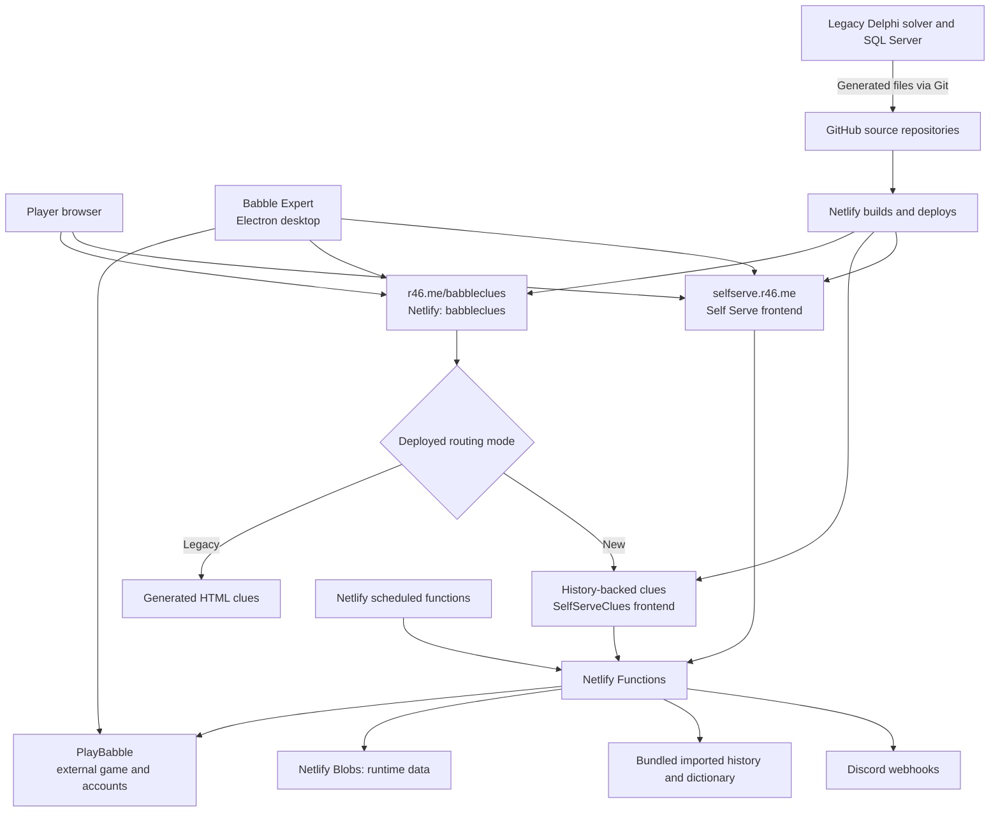
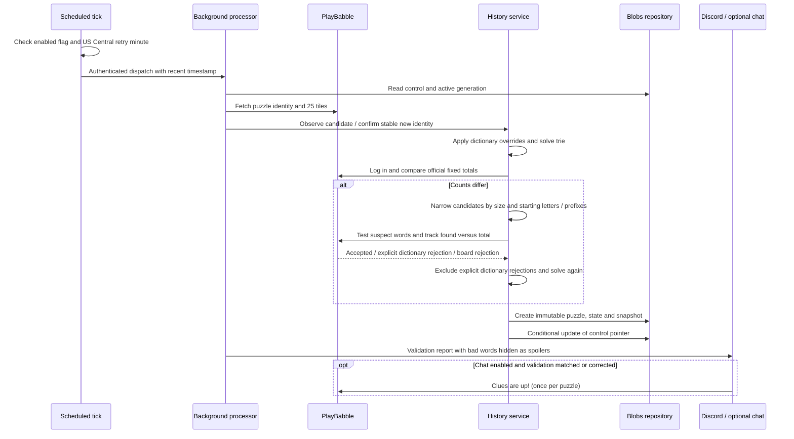
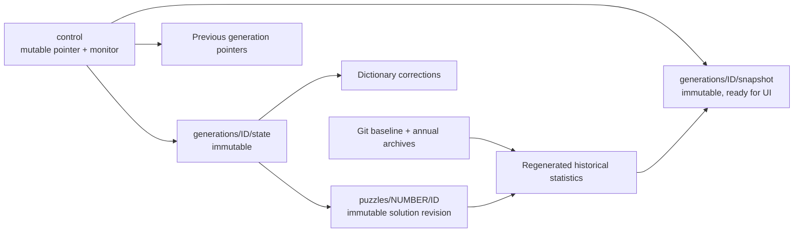
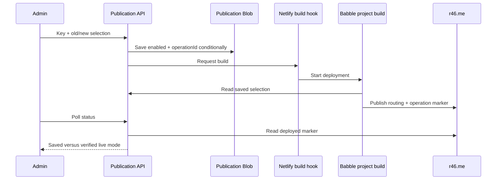

# Architecture and design

[Documentation home](README.md) · [Recovery](DISASTER-RECOVERY.md) · [SQL Server](SQL-SERVER-FAILOVER.md) · [Operations](OPERATIONS.md)

This describes the implemented system as of **20 October 2026**. “Preview” is the new history-backed clues page’s current name; it is intended to replace the old public page later. It is already a production-hosted application, with its own saved state.

## 1. Whole-system view

PlayBabble owns the game, official accepted-word decisions, the player account and chat. Our system reads the public board and uses one configured account for official-stat validation and candidate testing. It does not replace PlayBabble or back up its user accounts.

There are **two Netlify projects**, rather than two independent hosting providers:

| Project | Public address | Source / build |
|---|---|---|
| `selfserveclues` | `https://selfserve.r46.me/` | `SelfServeClues/main`, `npm run build`, publish `dist` |
| `babbleclues` | `https://r46.me/` | `Babble/main`, `node tools/build-clues-site.mjs`, publish `dist` via `netlify.toml` |

The stable backend origin used by the public-site proxy is `https://selfserveclues.netlify.app`. The switch changes the route at `r46.me/babbleclues`; it does not move data or servers. The build intentionally fails if it cannot fetch the saved selection, preserving the existing deployment.

## 2. Layers and technologies

| Layer | Technology | Role / key files |
|---|---|---|
| New website | React 19, TypeScript, Vite 8, HTML/CSS | Shared clues UI in [`src/App.tsx`](../src/App.tsx), history UI in [`src/history`](../src/history); built to static assets |
| Browser state | `localStorage`, memory | Checked/typed clues and local preferences; different visitors remain independent |
| Public-site delivery | Netlify static hosting, forced rewrites/proxies | Legacy/new page selection; [`Babble/tools`](https://github.com/licketySplitAUS/Babble/tree/main/tools) |
| Backend | JavaScript ES modules on Netlify Functions; Node 22 build configuration | HTTP APIs, background solver, scheduled dispatcher, authenticated administration |
| Runtime storage | `@netlify/blobs` 11 | JSON/text objects, immutable puzzle generations, receipts and checkpoints; no SQL database in this app |
| Imported storage | Gzip JSON files tracked by Git | Fixed historical baseline, dictionary and annual raw archives |
| External integration | HTTPS requests; HTML parsing / Cheerio | PlayBabble board/login/stats/submissions and Discord webhooks |
| Desktop | Electron 44, JavaScript, electron-builder, electron-updater | Locally installed Expert; loads live game/clue pages; GitHub Releases supplies installers |
| Legacy | Delphi and SQL Server | Old solver/database/generator; exports are separate from Netlify’s object model |
| Recovery | Node CLI, gzip JSON, Git bundles, T-SQL, standalone HTML | Read-only data extraction and explicit restoration to a new site |

Versions describe the current source, not a promise that platform runtimes will never change. There is no Netlify DB/Postgres instance: provisioning was unavailable for this account. Runtime persistence uses Blobs.

## 3. Two clues workflows

### Self Serve: solve in the browser

On page load, Self Serve loads the shared dictionary (or its bundled fallback), calls `/api/grab` to read the current board, and solves it locally. If fetching the live board fails, it tries `/api/grid`, the last saved shared board. **Grab Grid** is a manual retry; the initial page load already attempts the same fetch. The UI must retain the saved puzzle’s date so an older board is visible as older.

This path does not run the history service’s logged-in validation as part of each visitor’s load. Its optional shared `words.txt` override is a separate input from the history service’s baseline dictionary and corrections. Exporting both stores matters: do not assume the two dictionaries are automatically synchronized.

### Preview / new public clues: serve a saved solution

The history service solves centrally and saves a puzzle plus derived historical statistics. Visitors download the saved result; they do not log into the validation account or run that server solver. The frontend can fall back to the static imported snapshot if the current API is unavailable. That snapshot is the imported puzzle, **not an up-to-date disaster backup**.

Both pages share the clues UI, loading animation, word-list links, single-letter presentation and page counter. The counter is cosmetic; its failure should not prevent clue display.

## 4. Puzzle flip, solve and validate

The solver uses a trie: it walks adjacent tiles only while the letter sequence is a dictionary prefix. A tile is used once per word path. `Q` represents a single `Qu` tile. Scores match the original Delphi rules (including Q/U treatment), rather than assuming Scrabble scoring. Returned words include their score and one starting row/column.

The history service protects puzzle identity with valid date/number/board checks and two observations separated by at least 20 seconds for a newly observed grid. Admin’s explicit accept can bypass the waiting observation, while identity validation still applies. A manual grid requires an identity and a recorded reason.

Validation compares official denominators, because submitting a good candidate changes the account’s found-word numerators. The current Babble account exposes total words, lengths and starting-letter totals; two-letter totals are used if available. Otherwise candidates are grouped by our prefixes within the mismatching size/start buckets. Explicit `not_valid` membership rejection can create a permanent dictionary exclusion. A word that cannot be traced on this board (`dne`), a login failure or a timeout must not globally ban it.

An unresolved mismatch or unavailable login remains a reported validation result; successful publication alone is not proof of a match. The scheduler retries validation for an already published puzzle when needed. Public chat requires `matched` or `corrected` and the separate chat flag.

## 5. Storage model

| Store / source | Objects | Why it matters |
|---|---|---|
| `babble-history-preview-v1` | `control`; `generations/{id}/state` and `/snapshot`; `puzzles/{number}/{id}`; `notifications/...`; `settings/chat-announcements` | New puzzle history, correction decisions, rollback, notification/chat receipts and Admin chat setting |
| `babble-shared-data` | `current-grid`, optional raw-text `words.txt` | Self Serve’s last fetched board and optional replacement dictionary |
| `babble-publication` | Optional `mode` | Admin’s selected old/new public route and deployment operation status; no object means legacy/off |
| `babble-page-views` | `receipts/{uuid}`, `visits/{UTC-day}/{uuid}`, `checkpoints/{UTC-day}` | Shared visit ledger across refreshed clue pages |
| Git: `data/history/baseline.json.gz` | Canonical game metadata, aggregate, active/rejected dictionary, imported current game, `sourceVersion` | Fixed foundation required to interpret runtime state |
| Git: `data/history/archives/*.json.gz` | Raw historical games and words, including duplicate source rows | Archival fidelity and full-history SQL export |
| Git: `public/history-preview-data/*` | Static imported snapshot and audit | Website fallback and explanation of historical normalization |
| Netlify environment | Credentials, webhooks and settings | Deployment configuration; secret values excluded from code and data backups |
| Visitor browser / Expert local profile | Found words, typed answers, preferences, game cookies | Per-device state outside the site’s recovery backup |

The history baseline has a source checksum. Runtime state must match it; a changed baseline requires a deliberate migration rather than quietly combining different histories. Current/future word overrides do not rewrite earlier completed puzzles.

History publication writes the immutable objects first, then conditionally replaces `control` using its ETag. A competing publisher fails the pointer update and cannot silently overwrite a newer result. Old immutable objects allow rollback and are included in full runtime exports. Some unreferenced objects may remain after failed concurrent operations; they are retained rather than treated as corruption.

Production history, counter and publication code use site-wide stores; previews isolate those stores by deploy. **The older `/api/grab`, `/api/grid` and `/api/wordlist` code uses the site-wide shared-data store even from preview deployments.** Preview testing of those APIs can affect Self Serve’s shared input; avoid write tests against a live-linked preview. The new recovery endpoint requires production context and admin authorization.

Netlify documents the difference between [site-wide and deploy-specific Blobs](https://docs.netlify.com/build/data-and-storage/netlify-blobs/). A source-code rollback does not automatically roll back site-wide data.

### Visit counter

The starting count is **4,197,761 through 19 October 2026**, preserving the old counter. The inception date is **18 April 2006**. Each document load generates a UUID. Retries reuse it; refreshing generates a new one. The counter stores an immutable receipt and a day-index object per visit. A daily job creates an immutable checkpoint through two days ago. It does not use a shared read/increment/write numeric object.

Backups inventory a fixed set of objects. Visits arriving after that inventory are outside the backup’s cutoff. There is no atomic multi-store snapshot; a backup can include a receipt before its day index is created. This small in-flight uncertainty affects the cosmetic count, not the immutable puzzle generations. Counter objects currently accumulate; long-term retention/compaction is a future operational consideration, not an implemented deletion policy.

### Why historical totals differ from the old page

The import contained **7,424 raw game rows** and **1,309,176 game-word rows**. Canonical history selects the highest original `GameID` for each real puzzle number and counts each word once per game. Custom games and duplicate puzzle records remain in the raw archives. The current puzzle is excluded from the historical statistics until it becomes historical.

The original comparison showed 7,421 historical rows versus 7,266 canonical historical puzzles after the live puzzle was added. That **155-row difference** explains changes in word frequencies; it is not 155 missing daily puzzles. The imported audit separately lists gaps, invalid grids and mismatched source totals. Two selected canonical grids contain corrupt legacy tile strings; the raw archives contain three invalid-grid source rows overall. See [`data/history/audit.json`](../data/history/audit.json).

## 6. Triggers and endpoints

| Trigger / endpoint | Work |
|---|---|
| Page load → `/api/grab`, `/api/grid`, `/api/wordlist` | Fetch board, saved fallback, shared dictionary; Self Serve solves locally |
| `/history-api/current` | Serve saved current solution and statistics, short CDN cache; imported fallback is static |
| `history-tick`: `* 5-7 * * *` UTC | Lightweight dispatcher; local-time guard covers US Central DST and configurable start |
| `history-process`: background | Authorized recent dispatch; solve/validate/notify; longer candidate investigation fits here |
| `/history-api/admin`: authorized POST | Check, accept, rebuild, correction, manual grid, rollback, partial legacy backup, explicit notification tests |
| `/history-api/publication`: GET / authorized POST | Read selection/live marker; save desired mode and invoke legacy build hook |
| `/history-api/chat-settings`: GET / authorized production POST | Read/change the saved chat announcement switch without deploying or posting a message |
| `/api/page-counter`: GET / UUID POST | Read shared count / record document visit |
| `page-counter-checkpoint`: `0 4 * * *` UTC | Seal older visit days into immutable derived checkpoint |
| `/history-api/recovery`: authorized GET | Inventory or read a saved object; SQL staging and emergency HTML downloads |
| `/api/babble-notify`: POST | Opt-in Expert usage notifications to Discord; independent of solving |
| Git push or Netlify build hook | Build/deploy website; source update does not carry runtime Blobs with it |
| GitHub Expert release workflow | Build desktop installers and publish update assets |

Current flip checking is enabled with start minute **17**, meaning 00:17 US Central through the one-hour window. The scheduler tapers checks from every minute to five and ten minutes and sends a deadline report if the new puzzle is still unavailable. A matched/corrected current-day puzzle avoids another upstream solve. Chat remains disabled until explicitly enabled.

## 7. Public-page switch

The **saved Admin selection** is the source of truth. Although an environment-variable switch was discussed initially, the implementation does not require editing a Netlify boolean or storing a Netlify account token in a function. The build derives `USE_NEW_BABBLE_CLUES` internally from the saved selection. A secret, narrowly scoped build-hook URL starts the deploy. The page continues to serve its previous deploy while building.

`/new-babbleclues` always previews the new page on the original domain; `/legacy-babbleclues` preserves the generated legacy page. The public switch is separate from Admin's Babble chat announcement switch. The chat setting is saved in the history store and read for each notification invocation; it overrides the old `NotifyBabblersOfClues` environment fallback after its first Admin save. Changes need no deploy and do not post immediately. A switch-back also requires the old generator to supply a current puzzle if it has been stopped.

## 8. Boundaries and failure behaviour

Admin and recovery requests require `HISTORY_PREVIEW_ADMIN_KEY`; the key remains in Admin page memory. Credentials and webhooks are server-side. Backups include solutions, correction reasons and operational receipts, so keep the downloaded packs private. They contain no environment secret values, but should still be treated as operational data.

Discord delivery failure does not undo puzzle publication. Claims deduplicate notifications; an ambiguous public-chat send retains its claim to prevent duplicate announcements. Do not clear notification receipts casually during recovery.

A complete Netlify outage removes both websites, functions, scheduled jobs and access to the Blob backups stored there. A Netlify-hosted copy is therefore not an independent failover. GitHub plus an off-provider recovery pack lets you rebuild or serve static clues elsewhere. PlayBabble downtime is a separate external dependency and can prevent new-grid validation even if our hosting is healthy.
