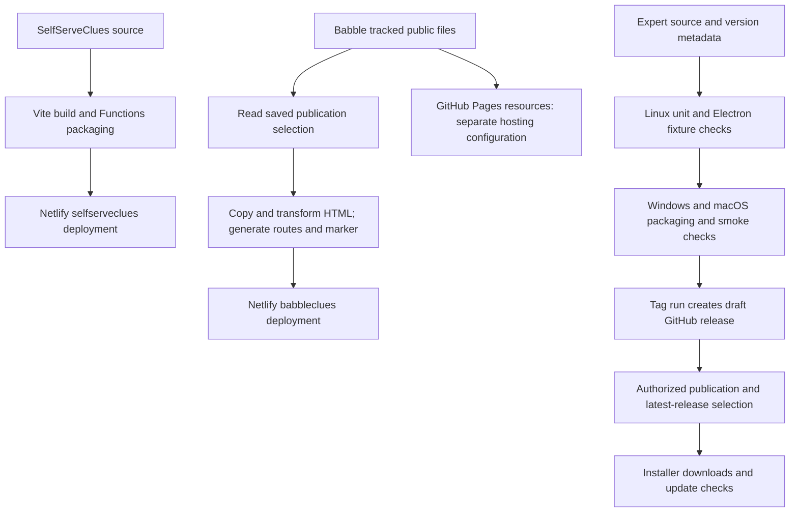

# Build, checks and release pipelines

[Developer guide](DEVELOPER-GUIDE.md) · [Architecture](ARCHITECTURE.md) · [Design principles](DESIGN-PRINCIPLES.md)

Checked against local manifests, tools and workflow source on **29 October 2026**. Netlify/GitHub dashboard settings, deployed commits and private backup runs were not reverified for this document. Commands below are local unless explicitly described as delivery steps. Run each from its repository root.

## Three delivery paths



A web change does not require an Expert installer unless packaged desktop code/assets change. A local build does not publish anything. A production-branch push may trigger deployment through the hosting integration; inspect that integration before promising a source-only push.

## SelfServeClues: local and hosted builds

Use Node >=22.13 and the committed lockfile. [`package.json`](../package.json), [`vite.config.ts`](../vite.config.ts) and [`netlify.toml`](../netlify.toml) are authoritative.

```powershell
npm ci
npm test
npm run typecheck
npm run build
node tools/history/package-check.mjs
npm run history:verify
```

Use affected tests during development; the full sequence is a useful pre-delivery gate for broad web/backend changes. History verification is especially relevant when changing imported data or interpretation. These checks do not deploy or exercise live credentials. `npm ci` runs the reviewed dependency mitigation in `tools/patch-braces.mjs`.

Vite emits the main Self Serve, history-backed clues and Admin HTML entries plus assets into `dist`. Netlify publishes `dist`, loads Functions from `netlify/functions`, and selects Node 22 for its build. History functions use esbuild; only archive-dependent handlers explicitly include `data/history/**`.

The packaging checker invokes the installed Netlify bundler locally. It checks routes, schedules, included archives and bundle sizes in `artifacts/history-packages`, without a site account or deployment. Keep it aligned with `netlify.toml` when adding included files or handlers.

No checked-in GitHub Actions build/test workflow is present in this repository at this review. The configured Netlify build runs `npm run build`; that command alone does **not** run tests, TypeScript checking or the packaging verifier. Do not assume those gates run automatically before a production deploy.

| Preview | Command | What it establishes |
| --- | --- | --- |
| Static built frontend | `npm run preview` | Vite's built assets; no Netlify Functions |
| Bundled-history fallback fixture | `npm run history:preview` after build | Loopback port 4175; deliberate unavailable history API |
| Frontend plus local Functions | `npm run dev` | Netlify Dev; effects depend on linked configuration and handler store selection |
| UI fixture scripts | `tools/history/*ui-check.cjs` | Built frontend checks using a separately available Electron runtime |

Electron is not a dependency of this repository. UI fixture scripts can use the Expert checkout's installed Electron binary; clear an inherited `ELECTRON_RUN_AS_NODE` and pass the script's absolute path when invoking it. Follow the individual script's setup; `npm run build` must precede checks that serve `dist`.

For an authorized deployment, record the target site/context and source SHA, run applicable checks, inspect changes, then use the existing Git/Netlify delivery path. Verify the deployed page and the affected endpoint/flow, including cache and old-client behaviour. A new site also needs its server-side environment, imported data and deliberate runtime initialization; cloning source does not restore production Blobs. Environment names and operating procedures are in [Operations](OPERATIONS.md) and [the project README](../README.md).

## Babble: public-site pipeline

This repository has no root npm package or dependency-install step. Use Node 22, Git, and PowerShell for dictionary generation.

```powershell
node --test tools/clues-routing.test.mjs tools/expert-button.test.mjs
node tools/build-clues-site.mjs
```

Tests are offline. The build performs a read of `https://selfserveclues.netlify.app/history-api/publication?config=1` with a 15-second deadline. Invalid/unavailable selection fails the build before copying output. This preserves the existing deploy instead of silently choosing another route.

The builder copies `git ls-files` into `dist`, excluding dot paths, tools, Markdown and build configuration. New public assets must be tracked to ship. Each HTML file receives the Expert-button, site-icon and clue-celebration transforms; the original clues are also preserved as `legacy-babbleclues.html`. The build generates forced old/new proxy routes and `clues-publication.json` containing mode, operation ID and build time. The marker has no-store headers.

The script does not clear an existing `dist`. Inspect production-style output from a fresh disposable checkout/build directory when checking the exact shipped file set; do not infer it from leftover local output. Inspect transformed output as well as source HTML. Netlify runs this build and publishes `dist`; no checked-in GitHub Actions workflow runs the tests for this repository at this review.

Resources consumed at `licketysplitaus.github.io/Babble/words-N.html` are a **separate GitHub Pages delivery path**. No checked-in Pages workflow establishes its current publishing settings. Verify repository Pages configuration and the served files for a resource release; successful Netlify deployment proves neither.

For a deliberate dictionary update:

```powershell
./generate-word-lists.ps1 -SourceCsv '<absolute-path-to-BabbleWordList.csv>'
```

Review all generated lengths 4–12. Preserve compact sorted word markup for current Expert and browser script interactions for older Expert. The default input assumes the maintainer's neighbouring checkout layout; use the explicit path elsewhere.

## Expert: development and packaging

Use Node 22+ and `npm ci` in the Expert repository. Application code is CommonJS JavaScript plus packaged HTML/CSS/JS.

```powershell
npm ci
npm test
npm run release:check
npm run test:e2e
```

`npm start` opens live websites using a development profile. For isolated interactive layouts, use `tools/preview/README.md`. Focused fixture tests run through `node test/e2e/run.js <test-file.js> --no-sandbox`, which isolates working directory/environment. Resource tests may require `WORD_LIST_DIR` pointing to the Babble checkout. The workflow lists the exact E2E set and environments; `npm run test:e2e` alone is not that full suite. `test:real-clues` uses live sites and is separate from fixture coverage.

Local packaging without publishing:

```powershell
npx electron-builder --publish never
node tools/release/check.cjs dist
```

Build on the appropriate OS and review target prerequisites. Windows produces per-user NSIS `BabbleExpert-Windows-Setup.exe`; macOS produces universal Intel/Apple Silicon `BabbleExpert-macOS.dmg`. Distribution is intentionally unsigned. A Windows check is not evidence of native macOS success. Linux directory output supports testing; it is not a public supported installer here.

### What GitHub Actions does

The authoritative workflow is Expert's `.github/workflows/build.yml`. It runs on manual dispatch and pushed `v*` tags:

1. **Linux test job:** installs dependencies, runs release metadata checks and unit tests, installs Xvfb/window-system dependencies, then runs the listed Electron fixture checks. Resource fixtures come from a checkout of Babble.
2. **Native build matrix:** Windows and macOS install from lockfile and package with publishing disabled and automatic signing discovery disabled. The artifact checker validates updater metadata, sizes, hashes and blockmaps and writes SHA-256 files.
3. **Native smoke checks:** Windows silently tests an upgrade from pinned **v3.3.0**, then a fresh install in a disposable CI path, checks shortcuts and uninstalls. The script is CI-only; do not bypass its guard on a maintainer workstation. macOS runs the packaged binary smoke test. Packaged tests use temporary profiles and fixture endpoints.
4. **Artifacts:** installers, update YAML, blockmaps and checksums are retained for seven days.
5. **Release job:** only a tag run creates a **draft**, with `RELEASE_NOTES.md` as its body and `make_latest: false`. Manual dispatch creates build artifacts without a release. Neither path automatically publishes a latest release.

### Release consistency and verification

For an authorized version change, align `package.json`, lockfile root version, four-part `build.buildVersion`, tag, release notes and offline highlights/history. `release:check` enforces the core metadata/highlight rules. Review player-facing wording and any requested wording approval before delivery. The old tour source/media remains for development but is excluded from installers.

Inspect the draft assets and checksums before authorized publication. Choose latest-release status deliberately: Windows' updater consumes GitHub release/update assets; macOS checks the latest release and offers a DMG replacement. Replacing a DMG is not a silent native update. Check download links, release version, YAML and asset availability after publication and verify the appropriate installed-client path. Building source is not proof an existing player has updated.

## Rollback and external jobs

| Problem | Correct boundary |
| --- | --- |
| Broken web code | Restore a known-good source/deploy; account for backend/runtime schema compatibility |
| Incorrect current history generation | Use documented history-data rollback; source rollback alone leaves site-wide Blobs intact |
| Wrong public route | Change desired mode and verify the matching deployed operation marker; the legacy page also needs a current puzzle |
| Bad desktop release | Stop promoting it and prepare a compatible corrective version; do not assume installed apps downgrade automatically |
| Provider outage | Use an off-provider recovery pack/host and DNS procedure, not the other Netlify site as independent failover |

The private `BabbleBackups` repository owns actual daily backup scheduling. This repository's [recovery workflow template](../tools/recovery/github-backup-workflow.yml) is not proof of the deployed private workflow. The newer [backup notes](../OPERATIONS.md) describe the daily full-backup/checkpoint/rehearsal arrangement; inspect actual private runs and backup-health state before claiming it succeeded. Historical drill records retain their original dates.
