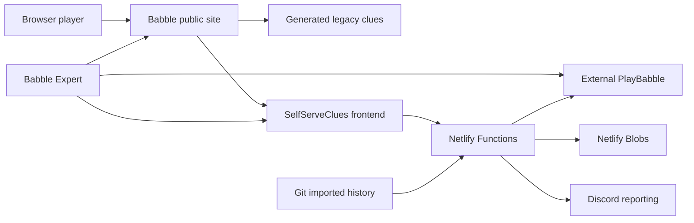

# Developer guide

[Documentation home](README.md) · [Architecture](ARCHITECTURE.md) · [Design principles](DESIGN-PRINCIPLES.md) · [Build and release](BUILD-AND-RELEASE.md)

This is the starting point for a developer joining the three Babble projects. The guide was checked against local source on **29 October 2026**. It describes implemented behaviour, not a fresh audit of production settings or installed releases.

## Reading path

1. Read the system map below and [Architecture](ARCHITECTURE.md) for the web/backend flows and storage model.
2. Read [Design principles](DESIGN-PRINCIPLES.md) for the constraints and tradeoffs behind the implementation.
3. Use [Build and release](BUILD-AND-RELEASE.md) to choose a local environment and understand what each delivery pipeline actually verifies.
4. For desktop work, read the [Expert documentation](https://github.com/licketySplitAUS/BabbleExpert/tree/main/docs) and its `ARCHITECTURE.md`. For public-site work, read the [Babble README](https://github.com/licketySplitAUS/Babble#readme).
5. Before storage, scheduler or publication changes, read [Operations](OPERATIONS.md), the newer [reliability/backup notes](../OPERATIONS.md), and [Disaster recovery](DISASTER-RECOVERY.md).

`AGENTS.md` contains instructions for coding agents; it is not a substitute for these human-oriented guides. The [implementation reference](AGENT-REFERENCE.md) provides more detailed contracts and test pointers when working on a particular feature.

## System and ownership



| Owner | Responsibilities | Start reading |
| --- | --- | --- |
| SelfServeClues | React clues/Admin, browser solver, centrally published history, validation, reporting, runtime recovery | [`src/App.tsx`](../src/App.tsx), [`src/history/App.tsx`](../src/history/App.tsx), [`netlify/lib/history/service.mjs`](../netlify/lib/history/service.mjs) |
| Babble | Generated public HTML, routing at `r46.me`, durable build transforms, dictionary resource pages | `tools/build-clues-site.mjs`, `tools/clues-routing.mjs`, `generate-word-lists.ps1` in that repository |
| BabbleExpert | Electron windows, word synchronization, Resources, local progress/settings, installers/updater | `src/main.js`, `src/app.js`, `src/engine.js`, `src/pages.js` in that repository |
| External systems | PlayBabble owns accounts, chat, board and word acceptance; legacy Delphi/SQL supplies original imports/generated pages | Neither is implemented by these three repositories |

Two public Netlify projects deliver the web system. Expert also downloads dictionary resources from GitHub Pages. These are separate delivery paths; changing one does not establish that the others have updated. See the build handbook before choosing which repository to change.

## First local session

Use Node **22.13 or newer** for this repository, Git and the committed lockfile. Run commands from the owning repository. No production secrets are needed for the fixture-based first session:

```powershell
npm ci
npm test
npm run typecheck
npm run build
npm run history:preview
```

The final command serves built files; open `http://127.0.0.1:4175/history-preview.html` to inspect history-backed clues. Its history API deliberately returns an unavailable response so you can inspect the bundled fallback. It does not emulate functioning Netlify APIs. Stop the server with Ctrl+C.

For API-backed development, `npm run dev` runs Netlify Dev. Read each handler's store selection and external effects before linking a site or adding credentials: old shared-grid handlers use a site-wide store, `/api/grab` can write even though it is GET, and absent deployment context does not guarantee notifications are disabled. Use test doubles for service tests. Never put secrets in `VITE_*`, which is browser-visible configuration.

Keep `npm ci`'s postinstall mitigation in [`tools/patch-braces.mjs`](../tools/patch-braces.mjs). It checks the targeted dependency before patching; a dependency change needs a deliberate reassessment.

## Trace common logic flows

### A player opens clues

There are two paths through the shared UI. **Self Serve** loads a dictionary and current/saved grid, then solves in the browser. **History-backed clues** load a precomputed snapshot from the backend; they do not run a fresh central solve per visitor. Start in [`src/App.tsx`](../src/App.tsx) and [`src/history/App.tsx`](../src/history/App.tsx).

[`shared/clues-snapshot.mjs`](../shared/clues-snapshot.mjs) handles snapshot loading; [`shared/live-clues.mjs`](../shared/live-clues.mjs) handles bounded visible/online refresh checks. A generation marker avoids repeatedly downloading unchanged full snapshots. Initial failure can show a dated local/bundled fallback; a later refresh failure retains the last usable view. Same-puzzle corrections reconcile valid found words; a new puzzle identity separates progress. All/On/Off remains a visitor choice.

### A new daily puzzle appears

Follow `history-tick` → [`schedule.mjs`](../netlify/lib/history/schedule.mjs) → `history-process` → [`service.mjs`](../netlify/lib/history/service.mjs). The dispatcher uses America/Chicago time. The service checks stable puzzle observations, solves, attempts official validation, builds immutable puzzle/state/snapshot objects, then conditionally advances the control pointer. See [the sequence and validation rules](ARCHITECTURE.md#4-puzzle-flip-solve-and-validate).

Publication can succeed with an explicitly recorded mismatch or unavailable validation. That does not prove the solution matches PlayBabble. Validation retry and chat eligibility are separate decisions. Only confirmed dictionary rejection can exclude a candidate globally; login, network and board-path failures cannot.

### An operator changes the public page

Follow [`netlify/lib/publication.mjs`](../netlify/lib/publication.mjs) and the publication handler. Admin saves desired mode plus an operation ID, invokes a build hook, then polls a marker deployed by the Babble build. A saved setting is not proof of live routing. See [the publication sequence](ARCHITECTURE.md#7-public-page-switch).

### Expert submits or synchronizes a word

Expert's pure engine coordinates external-page adapters through bounded execution and shared queues. Transfers require matching 25-letter grids and ready saved-word lists. The website must preserve `AddBabbleWord`, `GetAllWords`, `showAll`, `AddBulkWord` and the answer DOM hooks. See the desktop architecture for the complete flow; changing a hosted bridge can affect old installed clients immediately.

### Someone needs to restore data

Git restores source and the imported baseline, not subsequent Blob writes. Read the [recovery handbook](DISASTER-RECOVERY.md) and [newer backup/rehearsal notes](../OPERATIONS.md). Full runtime backups and validated-puzzle checkpoints are different artifacts. Restore preflight verifies content and target, writes objects create-only, and installs control pointers last. Keep writers off until the restored data is verified. A source rollback cannot undo site-wide runtime data.

## Repository map and change checks

| Change | Main locations | Useful checks |
| --- | --- | --- |
| Clue interaction or live refresh | `src/`, `shared/` | Relevant `test/live-clues.test.mjs` / UI fixtures, typecheck, build; inspect ordinary and Expert-embedded behaviour |
| Solver/history/corrections | `netlify/lib/history/`, `data/history/` | `test/history.test.mjs`, `test/babble-validation.test.mjs`, history verification |
| Public switch | Publication handler/library, Babble routing/build tools | `test/publication.test.mjs` and Babble's routing/transform tests |
| Reports and identity | `netlify/lib/alias-registry.mjs`, reporting functions | Alias integration, diagnostics, statistics and message tests for the changed path |
| Backups/storage | `netlify/lib/recovery*.mjs`, `tools/recovery/` | Recovery/batch tests, in-memory rehearsal, function packaging |
| Functions/config/dependencies | `netlify/functions/`, `netlify.toml`, manifests | `node tools/history/package-check.mjs` plus affected tests |

Use existing focused tests first; use the release handbook for broader gates. Import tools rewrite tracked data and are not setup commands. Review outputs before committing any generated baseline or dictionary change.

## Vocabulary and troubleshooting

**Puzzle identity** includes the official puzzle and grid; Expert uses the 25 grid letters because legacy clue numbers can be unreliable. **Generation** is an immutable state/snapshot revision. **Control** is the mutable pointer selecting the current generation. **Publication** can mean either committing a saved solution or deploying a public route: identify which operation you mean. **Preview** in historical filenames is not proof of isolation. **Visit**, **browser**, **installation**, **app-open duration** and **active journal time** are different metrics.

When debugging, first record the component, URL/app version, puzzle identity, generation if available, and whether the failure is local, hosted or packaged. Inspect bounded diagnostics and fixture tests before retrying external writes. Keep words, credentials, raw chat and private backup contents out of shared logs. For settings and operator procedures use the operations guides; do not infer current live flags from an old rollout note.

## Keeping this useful

Update the owning guide with changes to boundaries, contracts, commands or failure behaviour. Link to source rather than copying implementation. Record live verification separately with its date. Historical drills and rollout notes remain evidence of what was checked then, not a current service-status page.
