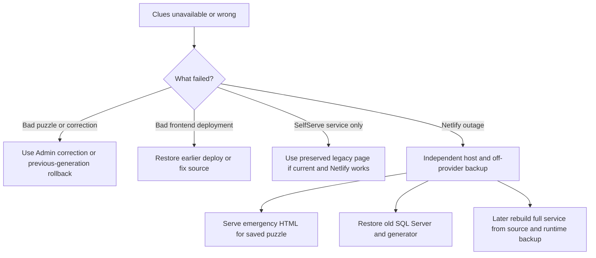

# Backup and disaster recovery

[Documentation home](README.md) · [Architecture](ARCHITECTURE.md) · [SQL Server failover](SQL-SERVER-FAILOVER.md)

## What position are we in?

**We can rebuild the code from GitHub, but GitHub alone cannot restore the current service.** The imported history is committed; subsequent puzzles, corrections and other runtime objects are in Netlify Blobs. Netlify keeps site-wide Blobs across deploys, but this is not an independent backup or an operator-controlled point-in-time restore.

The new recovery downloads cover the four application runtime stores. The local recovery pack adds the imported archive, Git bundles, SQL staging export, documentation and an emergency clues page. Keep the pack outside Netlify and copy it away from the computer that created it. A copy on a second folder of the same drive is not protection against losing that drive.

| Item | GitHub? | In the recovery pack? | Separate action |
|---|---|---|---|
| SelfServeClues code, build/routing config and tests | Yes | Git bundle | Save Node/dependency access for rebuilds |
| Imported baseline, dictionary, audit and raw annual archives | Yes | Separate files and Git bundle | Keep matching `sourceVersion` |
| New puzzles, old runtime generations, corrections, monitor and notification receipts | No | Runtime JSON | Back up regularly |
| Shared board and optional `words.txt` | No | Runtime JSON | Included even though independent of history |
| Publication selection | No | Runtime JSON if a `mode` object exists | Missing object means legacy/off |
| Shared page-view receipts/index/checkpoints | No | Inventoried runtime JSON | New/in-flight visits may be outside cutoff |
| Legacy public site code/pages | Yes | Optional `Babble.bundle` | Include `--legacy-repo` |
| Expert source and packaged source assets | Yes | Optional `BabbleExpert.bundle` | Include `--expert-repo` |
| GitHub Release installers and release metadata | Hosted by GitHub, not necessarily Git objects | No, unless separately archived | Download installers/update assets separately if required |
| Netlify secret values | No | No | Password manager / encrypted credentials backup |
| Netlify dashboard settings, domain certificates, deploy history | Partly represented by source config | No platform-account export | Recreate using this guide; save account access and DNS records |
| Netlify logs, Discord message history, PlayBabble account/game progress | No | No | Those services have their own data policies |
| Visitor’s local clue checks / typed words / Expert preferences | No | No | User browser/profile backup |
| Local original `.rpt` extracts and old Delphi project | Not fully | No | Back up their folders independently and privately |
| SQL Server schema, procedures, jobs, logins and original full database | No | No | Native SQL Server `.bak` and server configuration backup |

The source bundles contain **committed Git data only**, including local committed refs. Uncommitted and untracked files are excluded deliberately, and the manifest reports whether a source folder was dirty. Do not assume a Git bundle contains locally generated installers or private configuration.

## Low-usage GitHub backup option

For daily protection of correctly solved puzzles, see [Small daily GitHub backups](GITHUB-BACKUPS.md). The prepared workflow collects one validated puzzle checkpoint after the flip window, stores only new/changed content in a private repository, and triggers no website builds. It is a complementary strategy to the full runtime pack. Installing/enabling that workflow in the backup repository is a separate setup step; it is not activated by the Admin controls.

## Admin downloads

Open [Admin](https://selfserve.r46.me/history-admin.html), enter the admin key, then expand **Backup & recovery**:

1. **Download all runtime data** — gzip JSON inventory plus every listed object, original metadata and SHA-256 content checksums. Includes prior immutable generations, not just the active puzzle.
2. **SQL Server: current puzzle** — one puzzle and current dictionary overrides, as compressed T-SQL staging data.
3. **SQL Server: puzzles since import** — all current runtime puzzle records (including replacements of imported puzzles), plus overrides. Earlier revisions remain in the full runtime backup, not in this SQL view.
4. **Download emergency clues page** — self-contained HTML for the saved current puzzle, including grid, clue checks, typing fields, printing and answers hidden under a spoiler disclosure. No Netlify assets or APIs are required.

The older **Download preview backup** button remains available for compatibility. That export is a partial history-service snapshot; use **all runtime data** for recovery.

Backups are read-only. They do not solve a puzzle, change publication mode or send announcements. Admin downloads do not include source code or secrets. Keep a verified source bundle or GitHub clone alongside them.

## Make a portable recovery pack

Requires Node 22.13+ and Git. Run from a checkout of SelfServeClues with `npm install` already completed. Commands below are PowerShell examples; replace the example paths. Do not put a secret value in a command argument or commit it to a file in Git.

```powershell
# Create a fresh directory on your backup drive.
$backupRoot = 'D:\BabbleRecovery'
New-Item -ItemType Directory -Path $backupRoot -Force

# Private key file outside Git; alternatively supply HISTORY_PREVIEW_ADMIN_KEY
# through the process environment from your password manager.
node tools/recovery/recovery.mjs backup --key-file 'C:\Private\babble-admin-key.txt' --out "$backupRoot\runtime.json.gz"

node tools/recovery/recovery.mjs verify --input "$backupRoot\runtime.json.gz"

node tools/recovery/recovery.mjs pack --input "$backupRoot\runtime.json.gz" --out "$backupRoot\pack-2026-10-20" --legacy-repo 'D:\Source\Babble' --expert-repo 'D:\Source\BabbleExpert'

node tools/recovery/recovery.mjs verify-pack --input "$backupRoot\pack-2026-10-20"
```

Use a fresh output filename/folder for each run: files are not overwritten. To use an Admin-downloaded runtime backup, skip the `backup` command and supply that download as `--input`. `pack` does not fetch GitHub automatically: update/commit the source checkouts before packing if you need their latest code. The manifest records the exact local commit in each bundle.

Pack contents:

```text
manifest.json                 SHA-256 checksums and source commit IDs
README.txt                    Offline starting instructions and exclusions
runtime.json.gz               All inventoried application runtime objects
imported-history/             Baseline, audit, raw annual archives
SelfServeClues.bundle         Committed source/history, clone without GitHub
Babble.bundle                 If --legacy-repo supplied
BabbleExpert.bundle           If --expert-repo supplied
all-canonical-grids.sql.gz     Full canonical history + runtime replacements
babbleclues.html              Standalone current-puzzle clues
docs/                         This handbook, readable offline as Markdown
```

`verify` checks object checksums, inventory completeness, baseline identity and active/previous history references. `verify-pack` also checks the pack file checksums. Hashes detect accidental corruption, not malicious replacement of both a file and its manifest; protect the backup location itself.

### Repeatable backup script

[`tools/recovery/backup.ps1`](../tools/recovery/backup.ps1) runs download, pack and verification into a dated folder. Example:

```powershell
pwsh -NoProfile -File tools/recovery/backup.ps1 -Destination 'D:\BabbleRecovery' -KeyFile 'C:\Private\babble-admin-key.txt' -LegacyRepo 'D:\Source\Babble' -ExpertRepo 'D:\Source\BabbleExpert'
```

You can run that script from Windows Task Scheduler under your normal backup account, daily after the flip and after important corrections. It exits nonzero if any step fails. **No scheduled task or offsite destination is configured by adding this script.** The computer must be awake, Node/Git/dependencies available, and the key file readable by the scheduled account. Monitor failures and use a second provider/device for the output. Do not schedule credentials in plain-text task arguments; pass only the protected key-file path.

Suggested retention: seven daily packs and twelve monthly packs on an independent destination, plus a backup after dictionary/import changes. Deleting old backups is deliberately not automated here. A daily successful offsite run gives roughly one day of potential runtime data loss; this is a planning target, not a guarantee. Without that schedule, the recovery point is simply the last verified pack you retained.

## Snapshot consistency and growth

The exporter first lists a fixed inventory with ETags, downloads each object in bounded requests, and rechecks the history `control` pointer. If an inventoried object changes or disappears it fails and asks for a fresh export. It does not silently publish a mixed puzzle generation. Object downloads contain original bytes encoded as base64, with metadata and checksums.

This is not a transaction across four stores. New visits or objects created after inventory are excluded. Publication/shared-board changes after those objects were copied are outside that backup’s observed state. A counter receipt can be copied while its paired index is still in flight. For the strongest cut, pause writers and avoid visiting countable pages during export. Usually a stable post-flip backup is sufficient.

All current runtime objects are included, including unreferenced history generations and all accumulated visit records. Browser downloads assemble the backup in memory. Long-term high traffic will make full backups slower/larger; move to incremental/archive export and a retention policy if this grows beyond practical use. No retention deletion or incremental implementation is claimed here.

## During an outage: choose the right path



### Netlify healthy, application/deploy problem

Keep the existing service running while investigating. Data rollback and source deploy rollback are different operations. History’s previous-generation rollback can undo the active saved result. An older code deploy still reads site-wide runtime Blobs. The public-site old/new switch requests a new deployment; verify the deployed marker rather than assuming a saved selection is live.

If switching to legacy, verify that its puzzle is current. Once the old solver has been stopped, the preserved page becomes stale until that solver runs again. Its normal build also reads SelfServe’s publication API, so a broken API can block a new legacy build. An already published static legacy deploy may still work; the emergency standalone file removes that dependency.

### Complete Netlify outage: serve clues elsewhere

1. Find the latest verified pack on an independent device/provider.
2. Open `babbleclues.html` locally first. Check its **date, number, total and saved validation status**.
3. Upload it to an independent static host. Use `index.html` if that host requires it; preserve a `/babbleclues` or `/babbleclues.html` route where possible.
4. Test the alternate host directly before changing DNS. The page makes no external requests and its basic clues work without a build.
5. If using the existing domain, change DNS/hosting through the account that controls `r46.me`, provision HTTPS and check propagation. The DNS lookup at audit time returned `dns1`–`dns4.p08.nsone.net`; provider/account control and an independent DNS change path still need to be confirmed. This guide has not moved nameservers or provisioned another host.
6. Publish a new daily file with the old generator after restoring SQL Server, or use the offline solver below if the outage continues. The emergency file is a snapshot and **does not fetch tomorrow’s puzzle**.

Using a fresh hostname may require Expert’s trusted-origin rules and defaults to be updated. Keeping the established `r46.me` hostname avoids an app URL change, but still needs a working DNS/HTTPS cutover. Static fallback does not run Admin, history updates, page counters, webhooks, chat announcements or the full Expert word-transfer bridge. It is a readable emergency clues service.

### Make tomorrow’s clues locally during a long outage

The CLI can use the backed-up dictionary and corrections with a manually transcribed official board. This needs no Netlify or SQL Server. It **does not log in or validate against official totals**; the HTML visibly identifies the result as unverified. Check the puzzle identity, lengths, starting-letter totals and word count against PlayBabble before publishing.

```powershell
node tools/recovery/recovery.mjs solve --input 'D:\Recovery\runtime.json.gz' --puzzle 8616 --date 2026-10-20 --letters 'GHRPR AZRCW LNERS IEEHI HTOYD' --out 'D:\Recovery\offline-clues.html'
```

Pass the 25 letters as one argument, row by row, with `Q` for a Qu tile. For example, quote a spaced grid: `--letters 'GHRPR AZRCW LNERS IEEHI HTOYD'`. Replace the example with the actual day’s board. An optional `--sql-out 'D:\Recovery\offline-staging.sql.gz'` also produces staging SQL. Keep the adjacent `.html.game.json` output and any manual corrections for later reconciliation. This offline result does not update the runtime backup or stored historical statistics.

### Restore the full service to a new Netlify site

This path needs Netlify to be available. It also works after accidental site loss. It does not help while the entire provider remains unavailable.

1. **Clone the source bundle**, not a ZIP of the website’s built assets:

   ```powershell
   git clone 'D:\BabbleRecovery\pack-2026-10-20\SelfServeClues.bundle' 'D:\RecoveryWork\SelfServeClues'
   Set-Location 'D:\RecoveryWork\SelfServeClues'
   npm install
   node tools/recovery/recovery.mjs verify --input 'D:\BabbleRecovery\pack-2026-10-20\runtime.json.gz'
   ```

2. Create a **new** Netlify project from this source, Node 22, `npm run build`, publish `dist`, functions `netlify/functions`. Set `HISTORY_PREVIEW_SCHEDULE_ENABLED=false` and `NotifyBabblersOfClues=false` before deploying. Set/recover the admin secret and other required credentials from the password manager. Do not direct public traffic there yet, visit countable pages, trigger a solve or use a shared-wordlist replacement.
3. Supply a temporary Netlify token in the operator’s `NETLIFY_AUTH_TOKEN` process environment. It is used only by the local CLI, never stored in the app. Obtain the **new site UUID**.
4. Dry-run the restore:

   ```powershell
   node tools/recovery/recovery.mjs restore --input 'D:\BabbleRecovery\pack-2026-10-20\runtime.json.gz' --site NEW-SITE-UUID
   ```

5. Review the target, then apply explicitly:

   ```powershell
   node tools/recovery/recovery.mjs restore --input 'D:\BabbleRecovery\pack-2026-10-20\runtime.json.gz' --site NEW-SITE-UUID --apply --confirm-site NEW-SITE-UUID
   ```

   The tool refuses the original source site UUID. It validates the full backup, preflights every target store, refuses different/unexpected existing objects, and writes create-only. It permits identical-data resume after an interrupted restore. It publishes the history `control` pointer last. Keep **all target writers stopped**, because there is no cross-store transaction. If a conflicting target object exists, investigate or use another fresh site; do not casually delete a live store to make the tool proceed.

6. Check `/history-api/current`: puzzle number, date, grid, word/point totals, validation status, corrections and historical totals. Check `/api/grid` and `/api/wordlist` as needed. Test the new frontend, then the counter. Confirm the stored notification receipts were restored before considering announcements.
7. Recreate the legacy project from `Babble.bundle` if necessary. Update its stable SelfServe origin in the routing/build source if the replacement site has another `.netlify.app` name. Create a new narrowly scoped build hook and put it in the new service’s `BABBLE_PUBLICATION_BUILD_HOOK`. The restored `mode` is a desired setting; it has not deployed routes on the replacement legacy project. Review it before building or enabling public traffic.
8. Attach domains/HTTPS and verify old/new/print/admin/API/asset routes. Only then enable the scheduler and redeploy. Keep chat off until today’s validation and once-per-puzzle receipts are confirmed. Remove the temporary local token from your session when finished.

The restore path is covered by simulated storage tests. It has not been destructively rehearsed against production or a second real Netlify site. Plan a separate isolated-site drill before treating its recovery time as proven. No guaranteed recovery time is claimed; dependencies include account access, builds, data size and DNS propagation.

## Secrets and platform access checklist

Keep secret **values** outside Git, ideally in a password manager with recovery access. The pack intentionally contains names/documentation only.

| Name / access | Purpose |
|---|---|
| `HISTORY_PREVIEW_ADMIN_KEY` | Admin, background dispatch and backup authorization |
| `BABBLE_USERNAME`, `BABBLE_PASSWORD` | Official-stat validation and optional chat account |
| `BABBLE_PUBLICATION_BUILD_HOOK` | Triggers the legacy public project’s deployment; recreate for a replacement project |
| `DISCORD_WEBHOOK_URL`, `DISCORD_PUZZLE_WEBHOOK_URL` | Default and puzzle notices |
| Other `DISCORD_*_WEBHOOK_URL` settings used by message/usage handlers | Preserve configured message, install/session/upgrade routes |
| `WORDLIST_ADMIN_KEY` if configured | Protects shared dictionary replacement |
| GitHub and Netlify account recovery | Source, deploys, new projects and operational access |
| Domain registrar / DNS account | Independent-host failover and HTTPS domain verification |
| SQL Server / legacy generator credentials | Original system restoration |

Netlify’s [Secrets Controller](https://docs.netlify.com/build/environment-variables/secrets-controller/) can make secret values write-only. Do not rely on being able to read them back later. The application needs them in Functions scope; changes need a new deploy to take effect.

See [Operations](OPERATIONS.md) for nonsecret setting values and current project identifiers. Account-level DNS configuration, custom certificates, GitHub release assets, build dependencies and the native SQL backup require separate preservation.

## Verification record

The automated tests exercise unauthorized access, production-context gating, ETag changes, checksums, incomplete inventories, reference validation, create-only restoration with resume, preflight conflicts, SQL escaping/mapping, and portable emergency HTML. The operations record will note the actual pack and deployed endpoint checks made for this change. SQL Server execution and DNS failover require their own real-environment rehearsal.
