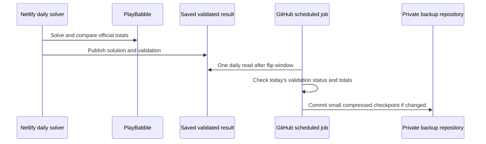

# Small daily backups to GitHub

[Documentation home](README.md) · [Full recovery guide](DISASTER-RECOVERY.md)

Keep a small GitHub copy of each puzzle after its word counts have been checked against Babble. That copy can recreate the day's clues page or supply the puzzle data for SQL Server recovery.

**The backup tools are ready, but automatic daily backup has not been enabled.** The setup steps below explain how to enable it in a separate private GitHub repository.

## Recommended approach: GitHub collects the validated result

GitHub runs a short task once a day after the normal puzzle checks finish:

1. Read today's saved puzzle from the clues service.
2. Confirm that its validation status is `matched` or `corrected`, and check the word and point totals.
3. Save a compressed copy in a **separate private backup repository**. Save another copy only when the puzzle or its corrections change.



Each saved copy includes the puzzle number and date, grid, words, scores, starting positions, validation result and dictionary corrections. It also records which imported dictionary version it needs. This small file is called a **puzzle checkpoint** in the tools below.

The task reads the same public saved result used by the clues page. It needs no Babble password, Netlify token or Admin key. GitHub supplies a temporary `GITHUB_TOKEN` to write to the private backup repository; no GitHub write token is stored in Netlify.

Keep the backup repository disconnected from Netlify so its commits cause no website builds. The template also adds `[skip netlify]` to its commit messages, as described in Netlify's [Manage deploys](https://docs.netlify.com/deploy/manage-deploys/manage-deploys-overview/) guide.

The supplied schedule is **08:23 UTC daily**, after the normal flip retry window in both US Central daylight and standard time. It is not an immediate callback from the solver. GitHub schedules can be delayed, and the workflow must be on the backup repository's default branch; see [GitHub workflow triggers](https://docs.github.com/en/actions/reference/workflows-and-actions/events-that-trigger-workflows#schedule). A direct event-triggered push is also possible, but needs additional credential/integration setup and reliable delivery/retry handling. The daily collector is the simpler first step.

## Usage and cost

- One short GitHub job and one read of the saved puzzle per day. No new solve, Babble login, candidate submission or chat message.
- No `npm install`, full-site build, full-history export or visit-ledger download in the job.
- One small gzip file per new or changed puzzle checkpoint. Identical results produce no commit. Revised results keep separate files rather than overwriting the earlier checkpoint.
- No exact price is promised: private-repository Actions usage depends on your GitHub plan and available minutes. Check the first few runs and the repository's Actions billing/usage page.

Measured on 20 October 2026: puzzle **8616**, with **147 words / 2,297 points**, produced a **1,425-byte** checkpoint. A second collection returned `unchanged`. Its checksum, emergency-HTML conversion and SQL-staging conversion passed local verification; the full-site restore command correctly refused this partial backup. The full test suite has 48 passing tests. These checks do not mean a private GitHub backup workflow has been installed or run.

If you prefer truly immediate backup after validation later, add a dispatch to a private backup workflow or a narrowly scoped GitHub integration. Avoid writing data to the website's production source branch, which normally triggers builds. Even an immediate hook should remain independent of successful puzzle publication: backup failure must not remove good clues.

## Install the prepared workflow

The tools are implemented and tested; **automatic GitHub backup is not activated merely by this documentation or the Admin page**.

1. Create a private repository, for example `BabbleDataBackup`, initialized with a README. Do not connect it to Netlify.
2. Copy [`tools/recovery/github-backup-workflow.yml`](../tools/recovery/github-backup-workflow.yml) into that repository as `.github/workflows/babble-backup.yml`, on its default branch. The template's current location deliberately does not activate a workflow in SelfServeClues.
3. Review the source checkout's `ref`. It defaults to `main`; preferably pin the verified SelfServeClues commit containing the checkpoint tool, updating it deliberately when the format changes.
4. Enable GitHub Actions for that repository and allow the workflow's declared `contents: write` permission, subject to any account/organization policies. Its temporary token can write only the backup repository. No personal access token needs to be copied into Netlify.
5. Run **Actions → Back up validated Babble puzzle → Run workflow**. Confirm a `puzzles/YYYY-MM-DD-puzzle-NUMBER-HASH.json.gz` file appears and the job succeeds. Running it again against an unchanged result should create no additional commit.
6. Review failure notifications and the date of the latest file. If today's puzzle is missing, validation is unresolved or the API is down, the job fails rather than silently backing up yesterday's result. Retry manually after the problem is resolved.

The workflow includes concurrency control so its own scheduled/manual runs cannot push over each other. Avoid unrelated writers to the backup branch during a run; a conflicting push fails visibly instead of force-pushing. GitHub scheduling is not a guaranteed delivery service. One daily run can miss a late correction or a puzzle that was not validated by run time; rerun after significant corrections and retain full runtime backups as well.

## Try the collector locally

Requires Node 22.13+ only; the collector itself has no third-party dependencies:

```powershell
node tools/recovery/puzzle-checkpoint.mjs --out 'D:\BabbleRecovery\puzzles'
```

By default it requires today's date in `America/Chicago`. `--date YYYY-MM-DD` allows an explicit date when verifying an already saved historical result; it does not fetch that date's puzzle from an archive. `--origin https://...` selects another deployed origin. The script checks the snapshot's validation and totals before writing anything. A checksum covers the canonical JSON payload; a same-content rerun preserves the existing file.

## Recover from a puzzle checkpoint

Clone/download the private backup repository and use a matching SelfServeClues source checkout with its dependencies installed:

```powershell
node tools/recovery/recovery.mjs verify --input 'D:\BabbleDataBackup\puzzles\YOUR-CHECKPOINT.json.gz'
node tools/recovery/recovery.mjs static --input 'D:\BabbleDataBackup\puzzles\YOUR-CHECKPOINT.json.gz' --out 'D:\Recovery\babbleclues.html'
node tools/recovery/recovery.mjs sql --input 'D:\BabbleDataBackup\puzzles\YOUR-CHECKPOINT.json.gz' --scope current --out 'D:\Recovery\puzzle-staging.sql.gz'
```

The HTML is independent of Netlify. SQL creates the documented recovery staging tables, without modifying the legacy `dbo` tables. The offline `solve` command also accepts a checkpoint as its dictionary-correction source when the imported baseline version matches.

A checkpoint **is not a full-site restore**: it has one puzzle and the correction map at that time, not every runtime generation, shared `words.txt`, counter, publication setting or notification receipt. The full-site `restore` command rejects it explicitly. There is no automatic merge of multiple checkpoint files back into live Blobs; use them for static/SQL recovery or a reviewed reconciliation with a full runtime restore. Continue occasional [full recovery packs](DISASTER-RECOVERY.md), native SQL backups and separately preserved secrets.
