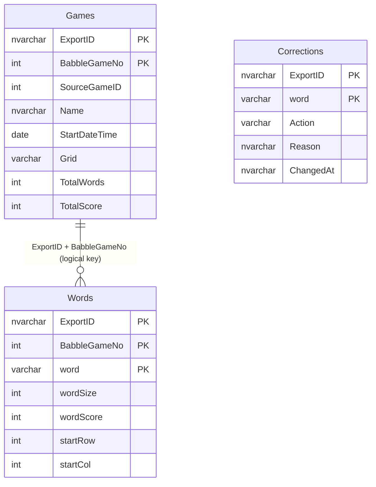

# Exporting grids and returning to SQL Server

[Documentation home](README.md) · [Recovery](DISASTER-RECOVERY.md) · [Architecture](ARCHITECTURE.md)

The new runtime stores JSON objects, not SQL tables. You can extract every canonical puzzle and its words, then load those into SQL Server. **A data export is not a full backup of the original database.** Returning to the old Delphi system also requires its schema, procedures, connection settings, executable/source and scheduled publishing setup.

Microsoft’s [full database backup documentation](https://learn.microsoft.com/en-us/sql/relational-databases/backup-restore/full-database-backups-sql-server?view=sql-server-ver17) explains the native database backup/restore path. Keep a tested `.bak` for that purpose, alongside the portable clues data.

## Exports available now

| Export | Where | Contents |
|---|---|---|
| Current puzzle | Admin → Backup & recovery | Current tiles/date/number, words, scores, start positions, corrections |
| Puzzles since import | Admin → Backup & recovery | Latest saved runtime record for every puzzle solved/revised by the new service, including replacements of imported puzzles |
| All canonical grids | Recovery CLI / full pack | Imported canonical history overlaid with latest runtime replacements; each puzzle once, each word once |
| Raw imported records | `data/history/archives/*.json.gz` / pack | Original game rows and word rows, including duplicates/custom games; archival JSON rather than a destructive SQL restore |
| Runtime revisions | Full runtime backup | All stored immutable versions, not just the latest SQL export |

The staging SQL derives word and point totals from the exported unique word rows. Original raw reported totals remain in the annual archives. This makes the canonical export agree with the new statistics rather than reviving duplicate rows from the old database.

## Commands without Netlify

Once you have a runtime backup and matching source checkout, these exports run entirely locally. No Netlify or PlayBabble access is needed:

```powershell
# From a SelfServeClues checkout with dependencies installed:
node tools/recovery/recovery.mjs sql --input 'D:\Recovery\runtime.json.gz' --scope current --out 'D:\Recovery\current.sql.gz'
node tools/recovery/recovery.mjs sql --input 'D:\Recovery\runtime.json.gz' --scope delta --out 'D:\Recovery\since-import.sql.gz'
node tools/recovery/recovery.mjs sql --input 'D:\Recovery\runtime.json.gz' --scope all --out 'D:\Recovery\all-grids.sql.gz'
```

Use `current`, `delta` or `all`; choose a fresh output filename. `all` reads each annual archive once, selects the imported canonical GameIDs and overlays runtime puzzles. It checks that the imported baseline version matches the runtime backup. The recovery pack generates this full file automatically.

Decompress the `.gz` with an archive tool, or PowerShell/.NET:

```powershell
$compressed = [IO.File]::OpenRead('D:\Recovery\all-grids.sql.gz')
$gzip = [IO.Compression.GZipStream]::new($compressed, [IO.Compression.CompressionMode]::Decompress)
$plain = [IO.File]::Create('D:\Recovery\all-grids.sql')
try { $gzip.CopyTo($plain) } finally { $plain.Dispose(); $gzip.Dispose(); $compressed.Dispose() }
```

Keep the runtime JSON and baseline too: SQL staging does not contain the complete immutable history, validation reports, rollback pointers, visit ledger or notification receipts.

## What the SQL script does

Run the decompressed script in a **recovery/staging database selected explicitly in SSMS**. It creates schema `BabbleRecovery` and these tables if absent. It does not select a database for you and never writes the old `dbo` tables.



`ExportID` is a unique batch identifier embedded in each file. A rerun of the same file replaces only its staging batch inside a transaction (`XACT_ABORT ON`). Another independently generated export creates another batch. Inserts use groups of at most 500 rows. Table relationships are logical; foreign-key constraints are not imposed on your recovery database.

The stage keeps `SourceGameID` for provenance. For imported rows that is the original SQL ID. For newly solved rows it currently equals the puzzle number, because the new service does not allocate SQL identities. **Never blindly insert it into old `tblBabbleGame.GameID`.** Allocate/map an appropriate GameID in the old database instead.

The old reports and Delphi insert statements show this mapping:

| New/staged data | Original SQL column | Meaning |
|---|---|---|
| `puzzle` / `BabbleGameNo` | `tblBabbleGame.BabbleGameNo` | Official puzzle number; canonical join key with date/grid review |
| `gameId` / `SourceGameID` | `tblBabbleGame.GameID` | Provenance only; allocate a database-specific target ID |
| `name` | `tblBabbleGame.Name` | Optional display name; new puzzles can use a generated name |
| `date` / `StartDateTime` | `tblBabbleGame.StartDateTime` | Puzzle calendar date; time-of-day is not retained by the import |
| `letters` / `Grid` | `tblBabbleGame.Grid` | 25 tiles, row-major; `Q` means Qu as one tile |
| Unique word count | `tblBabbleGame.TotalWords` | Derived from exported rows |
| Sum of word scores | `tblBabbleGame.TotalScore` | Derived from exported rows |
| Mapped target game ID | `tblBabbleGameWords.GameID` | Join words to the newly allocated/existing target game |
| `word`, its length, `score` | `word`, `wordSize`, `wordScore` | Keep stored scores; do not substitute Scrabble scoring |
| `startRow`, `startCol` | `startRow`, `startCol` | Preserved source positions; new solver uses 1–5, old records preserved verbatim |
| Override `action=exclude` | `tblFullList.NotInBabble=1` | Explicit dictionary rejection |
| Override `action=include` | Accepted dictionary decision | Review existing row and column semantics before changing flags |

The imported active/rejected lists are in `baseline.json.gz` as `dictionary` and `rejected`. Runtime overrides are separate. The import does **not** retain every original `tblFullList.NotInEnable` value or original time-of-day and SQL infrastructure. Use the native database backup/raw original reports when those fields matter. The optional Self Serve `words.txt` is a separate override and is not the history baseline.

## Check the staging data

Example read-only review queries after selecting the exported batch:

```sql
SELECT ExportID, COUNT(*) AS Puzzles, MIN(StartDateTime) AS FirstDate,
       MAX(StartDateTime) AS LastDate
FROM BabbleRecovery.Games
GROUP BY ExportID;

DECLARE @ExportID nvarchar(64) = N'paste-the-export-id-from-the-file';

SELECT g.BabbleGameNo, g.StartDateTime, g.TotalWords,
       COUNT(w.word) AS ActualWords, g.TotalScore,
       COALESCE(SUM(w.wordScore), 0) AS ActualScore
FROM BabbleRecovery.Games g
LEFT JOIN BabbleRecovery.Words w
  ON w.ExportID = g.ExportID AND w.BabbleGameNo = g.BabbleGameNo
WHERE g.ExportID = @ExportID
GROUP BY g.BabbleGameNo, g.StartDateTime, g.TotalWords, g.TotalScore
HAVING COUNT(w.word) <> g.TotalWords
    OR COALESCE(SUM(w.wordScore), 0) <> g.TotalScore;

SELECT BabbleGameNo, StartDateTime, Grid
FROM BabbleRecovery.Games
WHERE ExportID = @ExportID
  AND (LEN(Grid) <> 25 OR Grid COLLATE Latin1_General_100_BIN2 LIKE '%[^A-Z]%');
```

The totals query should return no rows. The full canonical export currently preserves two known corrupt historical grids: puzzle **3354** (2012-05-30) and **7105** (2022-09-07). Do not re-solve these malformed tile strings. They are retained to avoid silently changing recorded history. Raw source archives have three invalid-grid rows; canonical selection removes one of those duplicate source versions.

## Controlled return to the old generator

1. Restore the latest native database backup into an isolated SQL Server database. Validate it with the normal SQL Server integrity/restore checks. Preserve the original before applying updates.
2. Load the staging export there. Review the latest dates, official puzzle numbers, totals and the malformed historical rows above.
3. Identify puzzles missing from the restored legacy database. For each, allocate a safe target GameID using that database’s actual identity/allocation scheme and keep a mapping `(ExportID, BabbleGameNo) → target GameID`. Copy game and word rows together in a transaction. Review existing-puzzle differences separately rather than creating duplicates or overwriting historical results automatically.
4. Apply reviewed dictionary overrides to `tblFullList`. Exclusions map to the old `NotInBabble` flag. Restoring an imported decision removes an override in the new system, so the final baseline-plus-override state matters more than merely replaying recent actions.
5. Point the old Delphi generator at this recovery database and generate into a private output directory. Confirm date, grid, word count, point total and both clue formats. Avoid enabling two independent publishing jobs for the same public page.
6. For a Netlify outage, publish the generated static files to an independent host with their required image/resources paths and working HTTPS. The normal Netlify Git deployment cannot deliver them during a provider outage.
7. Once the new service is healthy again, reconcile any puzzles and corrections generated during failover before switching back. The new tools export data; there is no automatic SQL-to-Blobs import/reconciliation job. Do not discard those failover records.

No command in this change connects to or mutates the old SQL Server. SQL generation, escaping, row counts and source mappings are tested locally; execution against your actual server/schema, native restore and the Delphi publishing job still need an isolated rehearsal. This deliberate staging boundary prevents a convenient export button from unexpectedly changing twenty years of database history.
